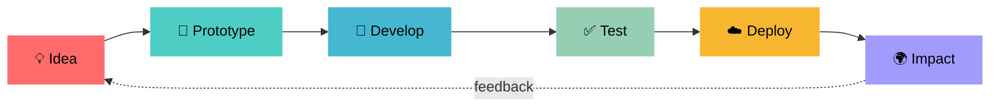

<!-- ===================== HEADER ===================== -->
<div align="center">


<a href="https://git.io/typing-svg">
  
</a>

<br/>


</div>

<br/>

<!-- ===================== ABOUT ===================== -->
## 👨‍💻 About Me

```python
class Developer:
    def __init__(self):
        self.name       = "Aryan Jaiswal"
        self.role       = "Student | Aspiring Software Engineer"      # <- edit
        self.location   = "India 🇮🇳"                                   # <- edit
        self.interests  = ["Web Development", "Cloud", "Data Science", "Open Source"]
        self.learning   = ["System Design", "DSA", "Cloud Architecture"]
        self.fun_fact   = "I turn coffee into code ☕"

    def say_hi(self):
        print("Thanks for stopping by! Let's build something great together 🚀")

Aryan = Developer()
Aryan.say_hi()
```

<table>
<tr>
<td>

🔭 **Currently working on:** *your current project here*
🌱 **Currently learning:** *Next.js, AWS, System Design*
🤝 **Open to collaborate on:** *open-source & web projects*
💬 **Ask me about:** *Java, Python, Web Dev*
⚡ **Fun fact:** *I turn coffee into code*

</td>
</tr>
</table>

<!-- ===================== SOCIALS ===================== -->
## 🌐 Let's Connect

<div align="center">

<a href="https://linkedin.com/in/YOUR-LINKEDIN-ID"></a>
<a href="mailto:jaiswalrn15@gmail.com"></a>
<a href="https://instagram.com/aryan_jaiswal"></a>
<a href="https://facebook.com/YOUR-FACEBOOK-ID"></a>
<a href="https://github.com/Aryanjaiswal15"></a>

</div>

<!-- ===================== TECH STACK ===================== -->
## 🛠️ Tech Stack

<details open>
<summary><b>💻 Languages</b></summary>
<br/>


</details>

<details open>
<summary><b>⚙️ Frameworks & Libraries</b></summary>
<br/>


&nbsp;


</details>

<details open>
<summary><b>🗄️ Databases, Cloud & DevOps</b></summary>
<br/>


</details>

<details open>
<summary><b>🧰 Tools & Design</b></summary>
<br/>


&nbsp;


</details>

<!-- ===================== GITHUB STATS ===================== -->
## 📊 GitHub Analytics

<div align="center">


<br/>


</div>

### 📈 Contribution Graph

<div align="center">
  
</div>

<!-- ===================== FEATURED PROJECTS ===================== -->
## 🚀 Featured Projects


<div align="center">
<table>
<tr>
<td align="center">
<a href="https://github.com/Aryanjaiswal15/REPO_NAME_1">
  
</a>
</td>
<td align="center">
<a href="https://github.com/Aryanjaiswal15/REPO_NAME_2">
  
</a>
</td>
</tr>
<tr>
<td align="center">
<a href="https://github.com/Aryanjaiswal15/REPO_NAME_3">
  
</a>
</td>
<td align="center">
<a href="https://github.com/Aryanjaiswal15/REPO_NAME_4">
  
</a>
</td>
</tr>
</table>
</div>

<details>
<summary><b>📂 Project details (click to expand)</b></summary>
<br/>

| Project | Description | Tech |
|---|---|---|
| **[Project One](https://github.com/Aryanjaiswal15/REPO_NAME_1)** | One-line description of what it does | `Java` `MongoDB` |
| **[Project Two](https://github.com/Aryanjaiswal15/REPO_NAME_2)** | One-line description of what it does | `Python` `Django` |
| **[Project Three](https://github.com/Aryanjaiswal15/REPO_NAME_3)** | One-line description of what it does | `Next.js` `AWS` |

</details>

<!-- ===================== WORKFLOW (Mermaid) ===================== -->
## 🔄 How I Build



<!-- ===================== TROPHIES ===================== -->
## 🏆 Achievements

<div align="center">
  
</div>

<!-- ===================== QUOTE ===================== -->
## 💬 Quote of the Day

<div align="center">
  
</div>

<!-- ===================== OPTIONAL: SNAKE ANIMATION =====================
To enable the snake, create .github/workflows/snake.yml (see Claude's instructions),
run it once, then uncomment the block below.

<div align="center">
  <picture>
    <source media="(prefers-color-scheme: dark)" srcset="https://raw.githubusercontent.com/Aryanjaiswal15/Aryanjaiswal15/output/github-snake-dark.svg" />
    
  </picture>
</div>
-->

<!-- ===================== FOOTER ===================== -->
<div align="center">

### ⭐ If you like my work, drop a star on my repos!


</div>
